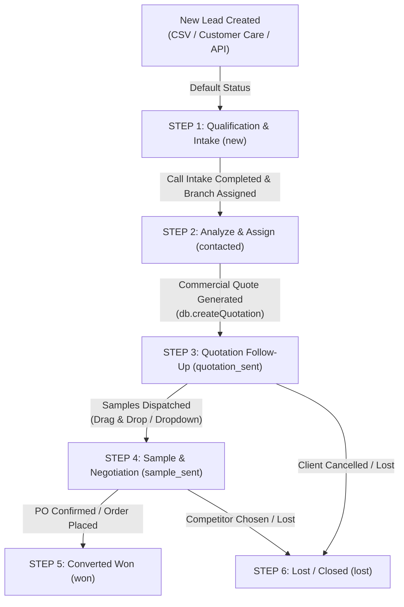

# Monipack CRM - Comprehensive Technical & Architectural Project Report

**Organization:** Morooj Nizwa International LLC  
**Headquarters:** Ghala, Muscat, Sultanate of Oman  
**Project:** Monipack Fullstack CRM & Order Management System  
**Audit Date:** November 2026  
**Auditor:** Automated Engineering Source Code Audit  

---

## Table of Contents
1. [Folder Structure (2 Levels Deep) & Component Purposes](#1-folder-structure-2-levels-deep--component-purposes)
2. [package.json Scripts & Dependencies](#2-packagejson-scripts--dependencies)
3. [npm audit Vulnerability Summary](#3-npm-audit-vulnerability-summary)
4. [Frontend API Base URL Configuration & Environment Variables](#4-frontend-api-base-url-configuration--environment-variables)
5. [Database Engine (server/db.js), Storage Path & Data Collections](#5-database-engine-serverdbjs-storage-path--data-collections)
6. [Complete API Route Map & Server-Side RBAC Enforcement](#6-complete-api-route-map--server-side-rbac-enforcement)
7. [CORS Configuration](#7-cors-configuration)
8. [Authentication, JWT, Password Hashing, Rate Limiting & Proxy Trust](#8-authentication-jwt-password-hashing-rate-limiting--proxy-trust)
9. [Hardcoded Secrets, Default Passwords, Users & Keys](#9-hardcoded-secrets-default-passwords-users--keys)
10. [File Uploads Architecture & Multer Status](#10-file-uploads-architecture--multer-status)
11. [Excel & CSV Import Methodologies](#11-excel--csv-import-methodologies)
12. [TallyPrime Integration & Background Synchronization](#12-tallyprime-integration--background-synchronization)
13. [Commercial Lead Stage Architecture & Pipeline Lifecycle](#13-commercial-lead-stage-architecture--pipeline-lifecycle)

---

## 1. Folder Structure (2 Levels Deep) & Component Purposes

```
monipack-crm/
├── .agents/                                # AI Agent guidelines and workspace guardrails
│   └── rules/                              # Specialized development rules and execution constraints
├── dist/                                   # Production build output compiled by Vite
│   ├── assets/                             # Bundled, minified JS, CSS, and hashed static chunks
│   ├── brands/                             # Static brand imagery copies for production serving
│   ├── fonts/                              # Web font distribution assets
│   ├── icons/                              # Production PWA and touch icons
│   ├── index.html                          # Single-page application entry point for production
│   ├── manifest.json                       # Progressive Web App (PWA) manifest file
│   └── sw.js                               # Production service worker script
├── node_modules/                           # External npm runtime and development packages
├── public/                                 # Static public assets served untouched by Vite
│   ├── assets/                             # App branding vector & raster logos (logo.svg, logo.png)
│   ├── brands/                             # Product division graphics (Monipack, Moniclean, Kohe, Monifood)
│   ├── fonts/                              # Cairo and custom font distribution files
│   ├── icons/                              # Favicons and PWA application icons (16x16, 32x32, apple-touch)
│   ├── .htaccess                           # Apache URL rewrite configuration for production SPA routing
│   ├── manifest.json                       # Web App Manifest defining standalone CRM mobile behavior
│   ├── monipack-logo.png                   # High-resolution Monipack corporate branding image
│   └── sw.js                               # Service Worker for offline asset caching and PWA support
├── scratch/                                # Internal diagnostic, testing, and UI validation scripts
│   ├── capture_drawer.cjs                  # Headless browser script testing drawer component visuals
│   ├── icon_generator.html                 # Canvas-based utility to render and export PWA icon assets
│   ├── inspect_dom.cjs                     # Puppeteer DOM inspection test script
│   ├── reproduce_print_mobile.cjs          # Mobile viewport print emulation script
│   ├── verify_activity_feed.cjs            # Test script verifying recent activity feed rendering
│   ├── verify_desktop_print_modal.cjs      # Print preview modal verification script
│   ├── verify_final_mobile_print.cjs       # Final mobile layout regression test
│   └── verify_redesigned_sidebar.cjs       # Responsive sidebar behavior test script
├── server/                                 # Express.js backend application & local data persistence
│   ├── data/                               # Persistent database directory storing JSON state
│   ├── db.js                               # Custom JSON database engine, query operations, and seed schema
│   ├── index.js                            # Primary Express server: routes, middleware, auth, and server entry
│   ├── leadImportService.js                # Lead CSV template generation, column mapping, and phone parser
│   ├── seed.js                             # Initial product catalog seeder and database initialization
│   ├── tallyService.js                     # TallyPrime XML HTTP connector, product parser, and variance engine
│   └── tallyWatchdog.js                    # Standalone background polling agent pushing Tally items to CRM
├── src/                                    # Frontend React application source code
│   ├── api/                                # Centralized API base URL resolver (config.js)
│   ├── components/                         # Modular UI components (modals, tables, cards, navigation)
│   ├── pages/                              # Primary top-level route views (Dashboard, Leads, Quotes, etc.)
│   ├── pwa/                                # Service worker registration and PWA bootstrap logic
│   ├── styles/                             # Design token definitions and styling variables
│   ├── App.jsx                             # Root React component managing global state, auth, and routing
│   ├── index.css                           # Global Tailwind CSS directives and custom typography rules
│   └── main.jsx                            # React 19 DOM bootstrap mounting #root
├── .env.development                        # Development environment variables
├── .env.production                         # Production environment variables
├── .gitignore                              # Git version control ignore rules
├── .htaccess                               # Apache rewrite & security headers configuration for cPanel hosting
├── app.js                                  # Production entry point for cPanel / Phusion Passenger Node.js
├── index.html                              # HTML5 entry template with viewport, PWA links, and runtime config
├── package-lock.json                       # Exact locked dependency graph tree
├── package.json                            # Project manifest, script targets, and dependency declarations
├── README.md                               # Project documentation and deployment runbook
├── start-crm.bat                           # Windows batch file to install dependencies and start CRM server
├── START_MONIPACK_CRM.bat                  # Enterprise production batch launcher with port check and auto-restart
├── start_background.vbs                    # VBScript runner to launch Node.js silently in background without CMD window
├── START_TALLY_AUTOSYNC.bat                # Windows batch runner to keep Tally watchdog polling active
├── stop_crm.bat                            # Utility batch script to terminate any process listening on port 5000
└── vite.config.js                          # Vite bundler build config, React plugin, and dev server proxy

```

### Specific Purpose of Scripts and System Folders

| File / Folder | Purpose & Architectural Role |
| :--- | :--- |
| `start-crm.bat` | Development starter script that checks if `node_modules` exists, runs `npm install` if missing, opens the browser to `http://localhost:5000`, and executes `node server/index.js`. |
| `START_MONIPACK_CRM.bat` | Production launcher. Checks via `netstat` whether port 5000 is active; if free, launches the default browser after 2 seconds and starts `node server/index.js` in an auto-restart infinite loop (`:loop`) so the server automatically recovers from crashes. |
| `start_background.vbs` | Windows VBScript wrapper that executes `node server/index.js` silently in the background with window style `0` (hidden), preventing terminal windows from staying open on staff workstations. |
| `START_TALLY_AUTOSYNC.bat` | Production watchdog launcher. Runs `node server/tallyWatchdog.js` inside an infinite loop with a 5-second backoff on process exit, ensuring continuous inventory synchronization between TallyPrime and Monipack CRM. |
| `stop_crm.bat` | Administration utility that uses `netstat -ano` to identify the Process ID (PID) occupying listening port 5000 and forcefully terminates it via `taskkill /F /PID`. |
| `.agents/` | Contains project instruction manuals for coding agents (`rules/web_fonts_and_branding.md` regarding Chromium font sanitizer OTS standards, and `rules/windows_tool_execution.md` regarding PowerShell script execution policies and command wrappers). |
| `scratch/` | Developer scratchpad containing Puppeteer UI test automation scripts (`inspect_dom.cjs`, `verify_final_mobile_print.cjs`, etc.) used to validate PDF generation, mobile responsive drawers, and print layouts without polluting application code. |
| `app.js` | cPanel / CloudLinux Passenger application entry point that simply executes `import './server/index.js'`, enabling zero-configuration deployments on shared and VPS cPanel hosts. |

---

## 2. package.json Scripts & Dependencies

*Source:* `package.json`

### Scripts
| Script Name | Command | Purpose |
| :--- | :--- | :--- |
| `start` | `node server/index.js` | Runs the Express backend server on port 5000 |
| `dev` | `concurrently "npm run server" "npm run client"` | Concurrently boots backend server and Vite frontend dev server |
| `client` | `vite` | Starts Vite development server on port 3000 |
| `server` | `node server/index.js` | Standalone backend server command |
| `build` | `vite build` | Compiles and bundles React frontend into `/dist` |
| `preview` | `vite preview` | Previews the compiled `/dist` bundle locally |
| `seed` | `node server/seed.js` | Executes the database seeder to populate sample catalog items |

### Production Dependencies
| Package | Version Range | Purpose |
| :--- | :--- | :--- |
| `bcryptjs` | `^3.0.3` | Password hashing and cryptographic verification |
| `clsx` | `^2.1.1` | Utility for conditionally constructing CSS class names |
| `cors` | `^2.8.5` | Express Cross-Origin Resource Sharing middleware |
| `express` | `^4.21.2` | Core Node.js HTTP web application framework |
| `jsonwebtoken` | `^9.0.3` | JSON Web Token (JWT) generation, signing, and verification |
| `lucide-react` | `^0.475.0` | Comprehensive SVG icon system for React |
| `multer` | `^1.4.5-lts.1` | Multipart/form-data upload library (*Unused in server code*) |
| `react` | `^19.0.0` | React core UI library (v19) |
| `react-dom` | `^19.0.0` | React DOM rendering package |
| `tailwind-merge` | `^3.0.2` | Utility to merge conflicting Tailwind CSS classes efficiently |

### Development Dependencies
| Package | Version Range | Purpose |
| :--- | :--- | :--- |
| `@tailwindcss/vite` | `^4.0.9` | Official Vite plugin for Tailwind CSS v4 |
| `@types/react` | `^19.0.10` | TypeScript type declarations for React |
| `@types/react-dom` | `^19.0.4` | TypeScript type declarations for React DOM |
| `@vitejs/plugin-react` | `^4.3.4` | Official Babel-based React Fast Refresh plugin for Vite |
| `autoprefixer` | `^10.4.20` | PostCSS plugin to parse CSS and add vendor prefixes |
| `concurrently` | `^9.1.2` | Utility to run multiple CLI commands concurrently |
| `postcss` | `^8.5.3` | CSS transformation pipeline tool |
| `tailwindcss` | `^4.0.9` | Tailwind CSS v4 utility-first CSS framework |
| `vite` | `^6.2.0` | Next-generation frontend build tool and dev server |

*Package Configuration:* `"allowScripts": { "esbuild@0.25.12": true }`

---

## 3. npm audit Vulnerability Summary

Execution of `npm audit` across the 289 installed packages reports **6 vulnerabilities** (1 Moderate, 3 High, 2 Critical). All vulnerabilities are located in transitive sub-dependencies and have fixes available via `npm audit fix`.

| Package | Severity | Vulnerability Summary & Advisory | Affected Range | Fix Available |
| :--- | :--- | :--- | :--- | :--- |
| **body-parser** | **High** | Denial of Service via trailing bytes after a compressed request body ([GHSA-27r3-jxmh-p828](https://github.com/advisories/GHSA-27r3-jxmh-p828)) | `<1.20.9` | Yes (`npm audit fix`) |
| **qs** | **Moderate** | Uncaught TypeError causing DoS via arrayFormat 'comma' with non-callable toString ([GHSA-6pq8-jhm2-2vcw](https://github.com/advisories/GHSA-6pq8-jhm2-2vcw)) | `>=6.7.0 <=6.16.0` | Yes (`npm audit fix`) |
| **shell-quote** | **Critical** | Command injection via line terminator in token after `{ comment }` token ([GHSA-pqg4-j6r4-53mv](https://github.com/advisories/GHSA-pqg4-j6r4-53mv)) | `>=1.8.4 <1.11.0` | Yes (`npm audit fix`) |
| **concurrently** | **Critical** | Dependency issue resulting from vulnerable versions of `shell-quote` | `9.2.3 - 9.2.4 \|\| 10.0.0 - 10.0.5` | Yes (`npm audit fix`) |
| **source-map-js** | **High** | Event-loop DoS through indexed source-map section offsets ([GHSA-68fv-2mgg-jv7q](https://github.com/advisories/GHSA-68fv-2mgg-jv7q)) | `>=1.0.0 <1.2.2` | Yes (`npm audit fix`) |
| **vite** | **High** | Multiple issues in `launch-editor` Windows path escaping and Vite custom middleware cross-origin script execution ([GHSA-698v-4r3x-3vcv](https://github.com/advisories/GHSA-698v-4r3x-3vcv), [GHSA-587h-7wmj-h5pm](https://github.com/advisories/GHSA-587h-7wmj-h5pm), [GHSA-9jrq-w75r-8gcw](https://github.com/advisories/GHSA-9jrq-w75r-8gcw)) | `<=6.4.3` | Yes (`npm audit fix`) |

**Summary Totals:**
- Low: 0
- Moderate: 1
- High: 3
- Critical: 2
- Total: 6

---

## 4. Frontend API Base URL Configuration & Environment Variables

### Location Where Frontend Sets API Base URL
- **File:** `src/api/config.js`
- **Lines:** 10–27 (`getBaseUrl()`) and Line 27 (`export const API_BASE_URL = getBaseUrl();`)
- **Helper Function:** `src/api/config.js` lines 34–42 (`getApiUrl(endpoint)`)

### Priority Hierarchy of API URL Resolution
1. `window.__MONIPACK_API_URL__` (Runtime override injected into `index.html` line 27; allows cPanel updates without rebuilding assets)
2. `localStorage.getItem('monipack_backend_url')` (Browser runtime developer override)
3. Localhost / Private Network detection: If hostname is `localhost`, `127.0.0.1`, `192.168.*`, or `10.*`, returns `''` (relative URL path, utilizing Vite reverse proxy or same-origin backend)
4. `import.meta.env.VITE_API_URL` (Baked at Vite build time)

### Environment Files Content (Variable Names Only)

#### `.env.development`
- `VITE_API_URL`

#### `.env.production`
- `VITE_API_URL`

*(No secret keys or passwords are stored in either file).*

---

## 5. Database Engine (server/db.js), Storage Path & Data Collections

### Database Architecture & I/O Mechanics
- **Engine Implementation:** Custom lightweight JSON file database encapsulated in the `Database` class in `server/db.js`.
- **JSON File Path:**
  - Relative: `server/data/monipack_crm.json`
  - Absolute: `C:\Projects\monipack-crm\server\data\monipack_crm.json`
  - Code references: `server/db.js` line 8 (`DATA_DIR = path.join(__dirname, 'data')`) and line 9 (`DB_PATH = path.join(DATA_DIR, 'monipack_crm.json')`).

### Reading Mechanism
- Executed synchronously on server instantiation via `Database.prototype.load()` (`server/db.js` lines 184–196).
- Checks `fs.existsSync(DB_PATH)`. If the file does not exist, it saves and returns `initialSchema`.
- If the file exists, it reads with `fs.readFileSync(DB_PATH, 'utf-8')` and parses with `JSON.parse(raw)`.
- Includes fallback exception handling that reverts to `initialSchema` if the JSON file is corrupted.

### Writing Mechanism
- Implemented as an **atomic file write** in `Database.prototype.save()` (`server/db.js` lines 198–202):
  1. Writes the full JSON state to a temporary file: `const tempPath = `${DB_PATH}.tmp`;`
  2. Uses synchronous UTF-8 writing: `fs.writeFileSync(tempPath, JSON.stringify(data, null, 2), 'utf-8');`
  3. Replaces the destination atomically via `fs.renameSync(tempPath, DB_PATH);`. This prevents corruption during sudden server restarts or power interruptions.

### Collections Inventory & Record Counts

| Collection Name | Record Count | Data Type Classification | Description & Action |
| :--- | :---: | :--- | :--- |
| `users` | 3 | **SETUP Data** *(To Keep)* | System user accounts with roles (`super_admin`, `admin`) and bcrypt password hashes. |
| `branches` | 15 | **SETUP Data** *(To Keep)* | Official Oman branch hubs (Ghala, Al Khoud, Mabela, Nizwa, Ibri, etc.) and assigned B2B salesmen. |
| `categories` | 11 | **SETUP Data** *(To Keep)* | Product & commercial lead categories (Packaging Products, Cleaning Products, etc.). |
| `pipelineStages` | 7 | **SETUP Data** *(To Keep)* | 6 commercial workflow pipeline stages + custom stages with UI styling classes. |
| `products` | 18 | **SETUP Data** *(To Keep)* | Monipack product catalog (SKU, English/Arabic names, unit price in OMR, stock, UOM). |
| `settings` | 1 *(Object)* | **SETUP Data** *(To Keep)* | Corporate metadata (Morooj Nizwa International LLC, tax, quote terms, currency OMR). |
| `leads` | 1 | **CUSTOMER Data** *(To Remove Later)* | Client inquiries, prospective customers, contact records, and pipeline statuses. |
| `quotations` | 1 | **CUSTOMER Data** *(To Remove Later)* | Issued commercial quotations, itemized lines, VAT calculations, and customer details. |
| `activities` | 16 | **CUSTOMER Data** *(To Remove Later)* | System audit log of user logins, stage transitions, WhatsApp dispatches, and imports. |

*(Note: Salesmen are embedded within the `branches` collection as the `salesman` field on each branch record).*

---

## 6. Complete API Route Map & Server-Side RBAC Enforcement

The table below lists every HTTP route defined in `server/index.js`, including the required authorization level and whether role enforcement is verified on the server.

| Method | Endpoint Path | Source Location | Permitted Roles / Callers | Role Checked on Server? | Server Enforcement Mechanism |
| :--- | :--- | :--- | :--- | :---: | :--- |
| `GET` | `/api/health` | `server/index.js:69` | Anyone (Public) | No | Unprotected diagnostic endpoint |
| `POST` | `/api/auth/login` | `server/index.js:187` | Anyone (Public) | No | Rate-limited by IP; authenticates credentials |
| `GET` | `/api/auth/me` | `server/index.js:239` | `super_admin`, `admin` | No | `authMiddleware` checks valid JWT only |
| `GET` | `/api/health` *(Duplicate)* | `server/index.js:246` | Anyone (Public) | No | Unprotected diagnostic endpoint |
| `GET` | `/api/analytics` | `server/index.js:258` | `super_admin`, `admin` | No | `authMiddleware` |
| `GET` | `/api/leads/export` | `server/index.js:268` | `super_admin` only | **YES** | `requireExportPermission` checks `req.user.role === 'super_admin' && req.user.canExport` |
| `GET` | `/api/leads` | `server/index.js:361` | `super_admin`, `admin` | No | `authMiddleware` |
| `GET` | `/api/leads/template` | `server/index.js:372` | Anyone (Public) | No | Unprotected public template download |
| `GET` | `/api/leads/:id` | `server/index.js:387` | `super_admin`, `admin` | No | `authMiddleware` |
| `POST` | `/api/leads` | `server/index.js:393` | `super_admin`, `admin` | No | `authMiddleware` |
| `PATCH` | `/api/leads/:id` | `server/index.js:412` | `super_admin`, `admin` | No | `authMiddleware` |
| `DELETE` | `/api/leads/purge-all` | `server/index.js:435` | `super_admin` only | **YES** | `requireSuperAdmin` checks `req.user.role === 'super_admin'` |
| `DELETE` | `/api/leads/:id` | `server/index.js:452` | `super_admin`, `admin` | No | `authMiddleware` |
| `POST` | `/api/leads/parse-csv` | `server/index.js:460` | `super_admin`, `admin` | No | `authMiddleware` |
| `POST` | `/api/leads/bulk-import` | `server/index.js:482` | `super_admin`, `admin` | No | `authMiddleware` |
| `POST` | `/api/leads/:id/activity` | `server/index.js:506` | `super_admin`, `admin` | No | `authMiddleware` |
| `GET` | `/api/products` | `server/index.js:525` | `super_admin`, `admin` | No | `authMiddleware` |
| `POST` | `/api/products` | `server/index.js:535` | `super_admin`, `admin` | No | `authMiddleware` |
| `PATCH` | `/api/products/:id` | `server/index.js:544` | `super_admin`, `admin` | No | `authMiddleware` |
| `DELETE` | `/api/products/:id` | `server/index.js:554` | `super_admin`, `admin` | No | `authMiddleware` |
| `POST` | `/api/products/bulk-delete` | `server/index.js:565` | `super_admin`, `admin` | No | `authMiddleware` |
| `GET` | `/api/products/template` | `server/index.js:583` | `super_admin`, `admin` | No | `authMiddleware` |
| `POST` | `/api/products/parse-csv` | `server/index.js:595` | `super_admin`, `admin` | No | `authMiddleware` |
| `POST` | `/api/tally/sync-push` | `server/index.js:610` | Watchdog Key OR Authenticated User | No | Checks `x-tally-key` or valid Bearer token |
| `POST` | `/api/products/bulk-import` | `server/index.js:656` | `super_admin`, `admin` | No | `authMiddleware` |
| `POST` | `/api/tally/test` | `server/index.js:681` | `super_admin`, `admin` | No | `authMiddleware` |
| `POST` | `/api/tally/fetch` | `server/index.js:692` | `super_admin`, `admin` | No | `authMiddleware` |
| `POST` | `/api/tally/sync` | `server/index.js:707` | `super_admin`, `admin` | No | `authMiddleware` |
| `GET` | `/api/quotations` | `server/index.js:736` | `super_admin`, `admin` | No | `authMiddleware` |
| `GET` | `/api/quotations/:id` | `server/index.js:745` | `super_admin`, `admin` | No | `authMiddleware` |
| `POST` | `/api/quotations` | `server/index.js:751` | `super_admin`, `admin` | No | `authMiddleware` |
| `PUT` | `/api/quotations/:id` | `server/index.js:772` | `super_admin`, `admin` | No | `authMiddleware` |
| `DELETE` | `/api/quotations/:id` | `server/index.js:786` | `super_admin`, `admin` | No | `authMiddleware` |
| `GET` | `/api/settings` | `server/index.js:803` | `super_admin` only | **YES** | `requireSuperAdmin` checks `req.user.role === 'super_admin'` |
| `PATCH` | `/api/settings` | `server/index.js:808` | `super_admin` only | **YES** | `requireSuperAdmin` checks `req.user.role === 'super_admin'` |
| `GET` | `/api/backup` | `server/index.js:822` | `super_admin` only | **YES** | `requireSuperAdmin` checks `req.user.role === 'super_admin'` |
| `GET` | `/api/users` | `server/index.js:838` | `super_admin` only | **YES** | `requireSuperAdmin` checks `req.user.role === 'super_admin'` |
| `POST` | `/api/users` | `server/index.js:842` | `super_admin` only | **YES** | `requireSuperAdmin` checks `req.user.role === 'super_admin'` |
| `DELETE` | `/api/users/:id` | `server/index.js:862` | `super_admin` only | **YES** | `requireSuperAdmin` checks `req.user.role === 'super_admin'` |
| `PATCH` | `/api/users/:id/password` | `server/index.js:878` | `super_admin` only | **YES** | `requireSuperAdmin` checks `req.user.role === 'super_admin'` |
| `GET` | `/api/config` | `server/index.js:900` | `super_admin`, `admin` | No | `authMiddleware` |
| `GET` | `/api/branches` | `server/index.js:909` | `super_admin`, `admin` | No | `authMiddleware` |
| `GET` | `/api/audit-logs` | `server/index.js:931` | `super_admin` only | **YES** | `requireSuperAdmin` checks `req.user.role === 'super_admin'` |
| `POST` | `/api/settings/categories` | `server/index.js:942` | `super_admin` only | **YES** | `requireSuperAdmin` checks `req.user.role === 'super_admin'` |
| `DELETE` | `/api/settings/categories/:name` | `server/index.js:964` | `super_admin` only | **YES** | `requireSuperAdmin` checks `req.user.role === 'super_admin'` |
| `POST` | `/api/settings/stages` | `server/index.js:980` | `super_admin` only | **YES** | `requireSuperAdmin` checks `req.user.role === 'super_admin'` |
| `DELETE` | `/api/settings/stages/:id` | `server/index.js:995` | `super_admin` only | **YES** | `requireSuperAdmin` checks `req.user.role === 'super_admin'` |
| `POST` | `/api/settings/branches` | `server/index.js:1010` | `super_admin` only | **YES** | `requireSuperAdmin` checks `req.user.role === 'super_admin'` |
| `PATCH` | `/api/settings/branches/:id` | `server/index.js:1025` | `super_admin` only | **YES** | `requireSuperAdmin` checks `req.user.role === 'super_admin'` |
| `DELETE` | `/api/settings/branches/:id` | `server/index.js:1039` | `super_admin` only | **YES** | `requireSuperAdmin` checks `req.user.role === 'super_admin'` |
| `ALL` | `/api/*` | `server/index.js:1054` | Anyone (Public) | No | 404 Shield returning JSON error response |
| `GET` | `*` / `/` | `server/index.js:1062` | Anyone (Public) | No | Serves SPA index.html or backend status JSON |

---

## 7. CORS Settings Exactly as Written in the Code

*Source:* `server/index.js`, lines 37–65

```javascript
const allowedOrigins = [
  'https://crm.monipack.com',
  'https://www.crm.monipack.com',
  'http://crm.monipack.com',
  'http://localhost:3000',
  'http://localhost:5000',
  'http://localhost:5173',
  'http://127.0.0.1:3000',
  'http://127.0.0.1:5000',
  'http://127.0.0.1:5173'
];

app.use(cors({
  origin: (origin, callback) => {
    if (!origin) return callback(null, true);
    if (
      allowedOrigins.includes(origin) ||
      origin.endsWith('.monipack.com') ||
      origin.endsWith('.onrender.com')
    ) {
      return callback(null, true);
    }
    return callback(null, true);
  },
  credentials: true,
  methods: ['GET', 'POST', 'PUT', 'PATCH', 'DELETE', 'OPTIONS'],
  allowedHeaders: ['Content-Type', 'Authorization', 'X-Requested-With']
}));
app.options('*', cors());
```

> **Security & Implementation Note:**  
> On line 59, the callback unconditionally executes `return callback(null, true);`. While intended to match `allowedOrigins`, `*.monipack.com`, and `*.onrender.com`, the final fallback line permits **any origin** to make authenticated requests with `credentials: true`.

---

## 8. Authentication, JWT, Password Hashing, Rate Limiting & Proxy Trust

### Authentication & Login Flow
- **Endpoint:** `POST /api/auth/login`
- **Location:** `server/index.js`, lines 187–236
- **Operation:**
  1. Requests pass through the `checkLoginRateLimit` middleware.
  2. Requires non-empty `email` and `password` fields in the request body.
  3. Queries the user by email using `db.getUserByEmail(email)` (`server/db.js` line 813).
  4. If user not found, invokes `recordFailedLogin(clientIp, email)` and returns `HTTP 401 Invalid email or password.`.
  5. Compares plaintext password against `user.passwordHash` via `bcrypt.compareSync(password, user.passwordHash)`.
  6. On failure, records the failed attempt and logs an activity alert to the audit trail.
  7. On success, clears failed attempt counters for that IP (`recordSuccessfulLogin(clientIp)`), generates a JWT token, writes a sign-in event to `activities`, and returns `{ token, user }`.

### JWT Token Architecture
- **Package:** `jsonwebtoken` (imported `server/index.js` line 6)
- **Token Signing:** `server/index.js` line 219
- **Token Expiry:** `24h` (24 hours) via `{ expiresIn: '24h' }`
- **Payload Structure:**
  ```javascript
  {
    id: user.id,
    name: user.name,
    email: user.email,
    role: user.role, // 'super_admin' or 'admin'
    canExport: user.canExport === true
  }
  ```
- **JWT Secret Origin:**
  - Evaluated on `server/index.js` line 35:
    `const JWT_SECRET = process.env.JWT_SECRET || 'monipack-om-crm-sec-2026';`
  - Originates from the host environment variable `JWT_SECRET`. If unset, it falls back to a hardcoded string.
- **Verification Middleware:** `authMiddleware` on `server/index.js` lines 151–165. Inspects `req.headers.authorization`, verifies Bearer token via `jwt.verify(token, JWT_SECRET)`, and attaches decoded data to `req.user`.

### Password Hashing
- **Package:** `bcryptjs` (imported `server/db.js` line 4 and `server/index.js` line 7)
- **Salt Generation:** `bcrypt.genSaltSync(10)` (10 work factor rounds)
- **Hashing Execution:**
  - User creation: `server/db.js` line 827
  - User password reset: `server/db.js` line 949
  - Seed users creation: `server/db.js` lines 859 and 874
- **Verification:** `bcrypt.compareSync(password, user.passwordHash)` on `server/index.js` line 202.

### Rate Limiter
- **Location:** `server/index.js`, lines 93–148
- **Storage:** In-memory `Map` (`loginAttempts = new Map()`), mapping `clientIp -> { count, resetAt }`.
- **Threshold & Window:** Maximum **5 failed attempts** per IP within a **15-minute lockout window** (`windowMs = 15 * 60 * 1000`).
- **Lockout Response:** If `record.count >= 5` and the lockout period has not expired, returns `HTTP 429` with error: `Security Lockout: Too many failed login attempts. Please wait X minute(s) before trying again.`
- **Audit Logging:** Every failed attempt records a `security_alert` entry in `db.addActivity` with the target email, IP, and attempt counter.
- **Memory Leak Protection:** `setInterval` runs every 15 minutes (`server/index.js` lines 137–147) to prune expired rate limit entries, with `.unref()` applied so as not to block server process termination.

### Express 'trust proxy' Setting
- **Status:** **NOT SET** (Absent).
- **Inspection Detail:** `app.set('trust proxy', ...)` does not appear in the codebase.
- **Client IP Extraction:**
  On `server/index.js` lines 97–100, the rate limiter retrieves the client IP using:
  ```javascript
  const clientIp = (req.headers['x-forwarded-for'] || req.socket.remoteAddress || '127.0.0.1')
    .toString()
    .split(',')[0]
    .trim();
  ```
  Because `trust proxy` is not enabled in Express, `req.ip` is avoided. However, directly parsing `req.headers['x-forwarded-for']` without Express reverse proxy validation allows clients to potentially spoof the first IP in the header if an edge proxy (like Cloudflare or an AWS ALB) does not sanitize incoming headers.

---

## 9. Hardcoded Secrets, Default Passwords, Users & Keys

*(Per audit instructions, actual values are masked with asterisks).*

| File & Line | Item Description | Type | Masked Value |
| :--- | :--- | :--- | :--- |
| `server/index.js:35` | Fallback JWT signing key when `process.env.JWT_SECRET` is unset | JWT Secret | `monipack-om-crm-sec-****` |
| `server/index.js:614` | Expected fallback sync key for Tally push synchronization | API / Sync Key | `monipack-tally-sync-****` |
| `server/tallyWatchdog.js:16` | Background Watchdog service fallback push authentication key | API / Sync Key | `monipack-tally-sync-****` |
| `server/db.js:851-863` | Default Super Administrator seed user account | Default User Email | `administrator@monipack.com` |
| `server/db.js:859` | Hardcoded default plaintext password passed to `bcrypt.hashSync` | Password | `Admin@Monipack****` |
| `server/db.js:866-878` | Default Admin seed user account (export restricted) | Default User Email | `admin@monipack.com` |
| `server/db.js:874` | Hardcoded default plaintext password passed to `bcrypt.hashSync` | Password | `Manager@Monipack****` |
| `server/data/monipack_crm.json` | Active production user account in persistent database | User Account | `itshamnas@gmail.com` |

---

## 10. File Uploads Architecture & Multer Status

### Multer Dependency Status
- **Finding:** While `multer` is declared in `package.json` under `"dependencies": { "multer": "^1.4.5-lts.1" }`, **it is completely unused in the backend code**.
- No `multer` middleware is imported or mounted in `server/index.js` or any other server file.
- There are no `multipart/form-data` endpoints configured on the server.

### Real File Upload Mechanism
- File handling is executed completely **client-side in the browser** via the HTML5 `FileReader` API:
  - `src/components/LeadImportModal.jsx` line 85: `const reader = new FileReader(); reader.readAsText(file);`
  - `src/components/TallyImportModal.jsx` line 109: `const reader = new FileReader(); reader.readAsText(file);`
- The file contents are read into memory as text strings and posted to the backend inside standard JSON request payloads:
  - Leads: `POST /api/leads/parse-csv` with body `{ csvData: content }`
  - Products: `POST /api/products/parse-csv` with body `{ csvData: content }`

### Size Limits
- Handled via Express JSON body parser on `server/index.js` line 66:
  `app.use(express.json({ limit: '15mb' }));`
- Maximum upload / payload size is **15 Megabytes**.

### Allowed File Types
- Enforced on the client-side file picker inputs:
  - **Leads:** `.csv, .txt, text/csv` (`src/components/LeadImportModal.jsx` line 277)
  - **Products / Tally:** `.csv, .txt, .xml, text/csv, application/xml, text/xml` (`src/components/TallyImportModal.jsx` line 395)

### Where Files Are Saved
- **Files are NEVER written or saved to disk as physical files on the server.**
- Uploaded CSV or XML content is parsed in memory by `leadImportService.js` or `tallyService.js`.
- When the user reviews and confirms the parsed data in the preview UI, the structured JSON array is dispatched to `/api/leads/bulk-import` or `/api/products/bulk-import`.
- The extracted records are saved directly into the persistent database file `server/data/monipack_crm.json`.

---

## 11. Excel & CSV Import Methodologies

### External Library Usage
- **No third-party spreadsheet libraries** (such as `xlsx` / `SheetJS`, `exceljs`, or `papaparse`) are used anywhere in the codebase.
- Excel binary workbooks (`.xlsx` or `.xls`) cannot be read directly; users export or save spreadsheets as CSV, plain text, or Tally XML before importing.

### Method Used to Read & Parse Files
Imports are processed using **custom pure JavaScript tokenizers** built directly into the codebase:

1. **RFC-4180 State-Machine Tokenizer (`server/leadImportService.js` lines 479–518 & `server/seed.js` lines 10–53):**
   - Iterates through the file string character by character.
   - Accurately tracks quotes (`inQuotes`), handles escaped double quotes (`""`), delimiters (`,`), and multi-line values across carriage returns (`\r\n` / `\n`).
   - Automatically detects and removes UTF-8 Byte Order Marks (`\uFEFF`) used by Microsoft Excel.

2. **Intelligent Column & Header Mapping (`server/leadImportService.js` lines 398–474):**
   - Implements fuzzy alias matching across localized and varied header titles (e.g. matching `company`, `client name`, `customer name`, `business` to the `name` field; `mobile`, `whatsapp`, `cell` to the `mobile` field).

3. **Oman Phone Normalizer (`server/leadImportService.js` lines 127–160 & `server/db.js` lines 83–117):**
   - Cleans non-digit characters, strips repeated `+968` prefixes, validates against Sultanate of Oman mobile numbering plans (8 digits beginning with 7 or 9), and generates consistent international formats (`+968 xxxxxxxx`).

4. **Product Line Tokenizer (`server/tallyService.js` lines 101–207):**
   - Parses CSV lines with quote awareness, normalizes headers (SKU, Item Name, Arabic Name, Stock Group, Brand, Unit, Price, Balance), strips currency formatting, and categorizes products.

5. **Tally Native XML Parser (`server/tallyService.js` lines 345–409):**
   - Uses regular expressions (`/<STOCKITEM[\s\S]*?<\/STOCKITEM>/gi`) to parse raw Tally XML exports (`Alt + E`), extracting `<NAME>`, `<PARENT>`, `<BASEUNITS>`, `<PARTNUMBER>`, `<STANDARDPRICE>`, and `<CLOSINGBALANCE>`.

---

## 12. Tally Integration & Background Synchronization

### How tallyService.js Works
- **File:** `server/tallyService.js`
- **Native HTTP Request Engine:** Utilizes Node's native `http` module (`http.request`) without external dependencies.
- **Port & Protocol:** Connects to TallyPrime's built-in XML Server over **HTTP port 9000** (`http://127.0.0.1:9000`).
- **Connection Test:** `testTallyConnection(tallyUrl)` (`lines 212–253`) issues an HTTP GET to `tallyUrl` with a 3000ms timeout to verify that TallyPrime is open with ODBC/XML connectivity enabled in *F1: Help -> Settings -> Connectivity*.
- **XML Query Construction:** `fetchTallyStockItems(tallyUrl, companyName)` (`lines 258–323`) crafts a Tally XML Export envelope:
  ```xml
  <ENVELOPE>
    <HEADER><TALLYREQUEST>Export Data</TALLYREQUEST></HEADER>
    <BODY>
      <EXPORTDATA>
        <REQUESTDESC>
          <REPORTNAME>List of Accounts</REPORTNAME>
          <STATICVARIABLES>
            <SVEXPORTFORMAT>$$SysName:XML</SVEXPORTFORMAT>
            <ACCOUNTTYPE>Stock Items</ACCOUNTTYPE>
          </STATICVARIABLES>
        </REQUESTDESC>
      </EXPORTDATA>
    </BODY>
  </ENVELOPE>
  ```
- **Variance Analysis Engine:** `parseUniversalProductData()` (`lines 416–484`) compares incoming Tally stock items with existing catalog products in the CRM, calculating price differentials (`priceDiff`), percentage changes (`priceDiffPct`), and identifying low-stock items.

### How START_TALLY_AUTOSYNC.bat & tallyWatchdog.js Work
- **Launcher (`START_TALLY_AUTOSYNC.bat`):** Sets the Node.js PATH environment variable and runs `node server/tallyWatchdog.js` inside an infinite loop with a 5-second backoff pause upon process termination.
- **Watchdog Agent (`server/tallyWatchdog.js`):**
  - Designed to run continuously on the local workstation or server running TallyPrime.
  - Configuration:
    - `TALLY_URL`: `http://127.0.0.1:9000` (Port 9000)
    - `CRM_HOST` & `CRM_PORT`: `127.0.0.1:5000` (Port 5000)
    - `SYNC_KEY`: `monipack-tally-sync-2026`
    - `POLL_INTERVAL_MS`: Every 60 minutes (default) or configurable via `process.env.POLL_INTERVAL_MINUTES`.
  - Execution cycle (`runSyncCycle()`):
    1. Verifies connectivity to TallyPrime on port 9000.
    2. Retrieves stock items and balances via `fetchTallyStockItems`.
    3. Formats payload and sends an HTTP POST to `http://127.0.0.1:5000/api/tally/sync-push`.
    4. Authenticates via the HTTP header `x-tally-key: monipack-tally-sync-2026`.

### Authentication Requirements for /api/tally Routes

| Route | HTTP Method | Auth Requirement | Mechanism |
| :--- | :---: | :---: | :--- |
| `/api/tally/sync-push` | `POST` | **Custom Key or JWT** | Checks `req.headers['x-tally-key'] === expectedKey` OR a valid Bearer JWT. Unauthenticated callers are rejected with `HTTP 401`. |
| `/api/tally/test` | `POST` | **Requires Auth** | Protected by `authMiddleware` (Requires valid Bearer JWT). |
| `/api/tally/fetch` | `POST` | **Requires Auth** | Protected by `authMiddleware` (Requires valid Bearer JWT). |
| `/api/tally/sync` | `POST` | **Requires Auth** | Protected by `authMiddleware` (Requires valid Bearer JWT). |

---

## 13. Commercial Lead Stage Architecture & Pipeline Lifecycle

### The 6 Commercial Pipeline Stages
The Monipack commercial sales cycle is modeled across six linear stages defined in `server/db.js` (lines 28–35) and `src/pages/Leads.jsx`:

| Stage ID | Official Label | Visual Styling (Border / Fill) | Purpose & Operational Milestone |
| :--- | :--- | :--- | :--- |
| `new` | **STEP 1: Qualification & Intake** | Blue (`border-blue-500 bg-blue-50/20`) | Incoming inquiry captured via phone, website, or CSV import. Sits in Customer Care Call Queue awaiting qualification. |
| `contacted` | **STEP 2: Analyze & Assign** | Indigo (`border-indigo-500 bg-indigo-50/20`) | Customer Care team member has contacted client, gathered technical packaging specs, and assigned branch/salesman. |
| `quotation_sent` | **STEP 3: Quotation Follow-Up** | Amber (`border-amber-500 bg-amber-50/20`) | Official commercial quotation generated and delivered. Follow-up cycle active. |
| `sample_sent` | **STEP 4: Sample & Negotiation** | Purple (`border-purple-500 bg-purple-50/20`) | Physical packaging samples dispatched; price/commercial terms under negotiation. |
| `won` | **STEP 5: Converted (Won)** | Emerald (`border-emerald-500 bg-emerald-50/20`) | Purchase Order (PO) confirmed or commercial invoice raised. Deal won. |
| `lost` | **STEP 6: Lost / Closed** | Rose (`border-rose-500 bg-rose-50/20`) | Opportunity closed without conversion. Requires a `lostReason` (e.g. price, lead time). |

### Stage Progression Mechanics



### Lead Lifecycle Rules & Automated Triggers
1. **Intake Default:**
   All newly created leads (via manual entry in `POST /api/leads` or bulk import in `POST /api/leads/bulk-import`) default to `status: 'new'`, placing them into Customer Care's qualification queue.
2. **Automated Quotation Linkage:**
   When an official quotation is created for a lead (`db.createQuotation()` in `server/db.js` lines 653–658), the system **automatically triggers a state transition**:
   ```javascript
   if (newQuotation.leadId) {
     this.updateLead(newQuotation.leadId, {
       status: 'quotation_sent',
       dealValue: grandTotalOMR,
     });
   }
   ```
   The lead is moved directly to Step 3 (`quotation_sent`), and the lead's estimated deal value is synchronized with the quotation's Grand Total (including 5% Oman VAT).
3. **Audit Trail Logging on Stage Changes:**
   In `server/index.js` lines 419–426 (`PATCH /api/leads/:id`), every status transition triggers an audit log entry in the `activities` collection:
   `Stage changed from "${prev.status}" to "${req.body.status}" by ${req.user.name}`.
4. **Communication Activity Touchpoints:**
   Logging a customer communication via `POST /api/leads/:id/activity` (`server/index.js` lines 506–522) with type `call` or `whatsapp` automatically updates the lead's `lastContactedAt` timestamp to the current ISO date.
5. **Frontend UI Stage Controls:**
   - **Kanban Drag-and-Drop:** Built into `src/pages/Leads.jsx` (lines 240–252) allowing desktop users to drag cards between stage columns.
   - **Quick Stage Progression:** Individual lead cards render a forward progression button (`getNextStage()`), allowing one-click advancement to the subsequent stage.
   - **Mobile Single-Stage Focus Carousel:** On mobile devices, `src/pages/Leads.jsx` renders a horizontal pill carousel that focuses on a single stage column at a time to optimize screen space.
   - **Customer Care Direct Intake:** `src/pages/CustomerCare.jsx` allows immediate transition from `new` to `contacted` upon completing customer intake notes and branch hub assignment.

